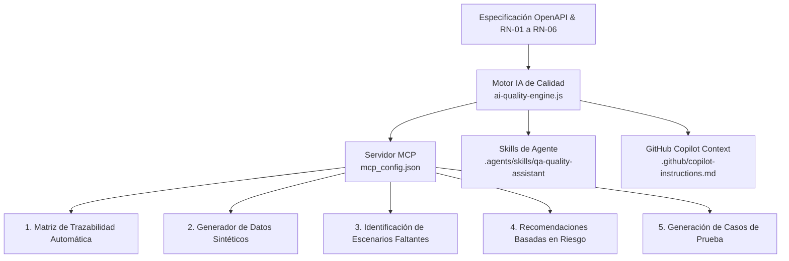

# 🏆 Reto Técnico: Ingeniero/a de Software QA de Calidad TI (Semi Senior)
## API REST para Gestión de Órdenes de Compra con Quality Gates y Pruebas Automatizadas

[](https://github.com/AlejaRV/gestion-compras/actions/workflows/ci.yml)
[](https://www.oracle.com/java/)
[](https://spring.io/projects/spring-boot)
[](docs/evidence/jacoco-summary.html)
[](docs/evidence/pitest-summary.html)
[](docs/evidence/karate-summary.html)
[](src/test/java/com/challenge/orders/e2e/playwright/OrdersWebPlaywrightIT.java)

---

## 📌 1. Descripción de la Solución y Decisiones Técnicas

Esta solución implementa una **API REST de grado transaccional** para la gestión del ciclo de vida de órdenes de compra, diseñada bajo los principios de **Clean Architecture**, **Domain-Driven Design (DDD)** y una rigurosa estrategia de calidad con **Quality Gates automáticos**.

### 💡 Decisiones Técnicas Clave:
1. **Precisión Financiera con `BigDecimal`:** Se prohibió el uso de tipos primitivos de punto flotante (`float`, `double`) en el cálculo de subtotales y totales para evitar errores acumulativos de redondeo binario (`RN-03`).
2. **Máquina de Estados en el Dominio (`RN-06`):** Implementada dentro del enum `OrderStatus` como una tabla inmutable de transiciones permitidas. Los estados terminales (`ENTREGADA`, `CANCELADA`) no admiten ninguna transición posterior.
3. **Borrado Lógico y Auditoría (`RN-04`):** El endpoint `DELETE /orders/{id}` no elimina físicamente registros; cambia el estado a `CANCELADA` para preservar trazabilidad histórica y rechaza con `409 Conflict` si la orden ya fue entregada.
4. **Respuestas de Error Homogéneas (RFC 7807):** Todas las excepciones de negocio y de validación retornan `application/problem+json` con campos estructurados: `type`, `title`, `status`, `detail`, `code` (código de regla violada) y `correlationId`.
5. **Observabilidad Distribuida:** Filtro `CorrelationIdFilter` que propaga y registra el encabezado `X-Correlation-Id` en los logs del servidor (MDC).

---

## 🏛️ 2. Arquitectura de la Solución

```
src/
├── main/
│   ├── java/com/challenge/orders/
│   │   ├── domain/          # Entidades (Order, OrderItem, OrderStatus con Máquina de Estados)
│   │   │   └── exception/   # Jerarquía de DomainException con códigos de reglas de negocio
│   │   ├── repository/      # Puertos e Implementación InMemory concurrente y portable
│   │   ├── service/         # Casos de uso de negocio y orquestación
│   │   └── web/             # Adaptador REST (Controllers, DTOs y Problem Details RFC 7807)
│   └── resources/
│       ├── static/          # Frontend Web moderno para consumo E2E y pruebas manuales
│       └── application.yml  # Configuración, Swagger y Actuator Probes
```

---

## ⚙️ 3. Reglas de Negocio Implementadas

| Regla | Descripción | Manejo / Código HTTP |
| :--- | :--- | :--- |
| **RN-01** | La orden debe contener al menos un producto | `400 Bad Request` (`VALIDATION_ERROR`) |
| **RN-02** | Cantidad y valor unitario deben ser > 0 | `400 Bad Request` (`VALIDATION_ERROR`) |
| **RN-03** | Cálculo automático del total: $\sum(cantidad \times valorUnitario)$ | `201 Created` / `Order.calculateTotal()` |
| **RN-04** | Una orden entregada **no puede ser cancelada** | `409 Conflict` (`RN-04`) |
| **RN-05** | Una orden **no puede ser enviada si no ha sido pagada** | `400 Bad Request` (`RN-05`) |
| **RN-06** | Transiciones inválidas de estado son rechazadas | `409 Conflict` (`RN-06` con detalle exacto) |

### 🔄 Máquina de Estados Finitos
```
[ CREADA ] ──► [ PAGADA ] ──► [ ENVIADA ] ──► [ ENTREGADA (Terminal) ]
    │              │               │
    └──────────────┴───────────────┴────────► [ CANCELADA (Terminal) ]
```

---

## 🛡️ 4. Estrategia de Calidad y Pirámide de Pruebas

Nuestra estrategia concibe la calidad como una **responsabilidad transversal, medible y preventiva**, aplicando una pirámide de pruebas balanceada donde cada nivel mitiga un riesgo específico:

```
                  / \
                 /   \
                / E2E \         --> Playwright & Serenity BDD (UI Web completa)
               /───────\
              / Aceptac.\       --> Karate Framework (25 escenarios BDD / Contratos HTTP)
             /───────────\
            /  Mutación   \     --> PIT Mutation Testing (59 mutantes evaluados - 98% Score)
           /───────────────\
          /   Unitarias     \   --> JUnit 5 + Mockito + JaCoCo (125 pruebas - 100% Cobertura)
         /───────────────────\
```

### 🧠 Casos de Automatización de Nivel Senior Diseñados e Implementados

Como Ingeniero de Automatización Senior, más allá de los flujos elementales, se diseñaron pruebas para mitigar **riesgos de borde, integridad transaccional y resiliencia**:

| Categoría de Riesgo | Nivel de Prueba | Caso de Automatización Diseñado | Justificación de Riesgo |
| :--- | :--- | :--- | :--- |
| **Integridad Transaccional** | Karate (API) | Ciclo de vida completo encadenado (`CREADA ➔ PAGADA ➔ ENVIADA ➔ ENTREGADA`) | Valida que el total monetario no mute durante las transiciones de estado. |
| **Matriz Completa de Estados** | Unitarias | Prueba parametrizada de matriz 5x5 de transiciones posibles | Mitiga el riesgo de regresión o bypass accidental de estados terminales. |
| **Ataque de Payloads Nulos/Vacíos** | Karate & Unitarias | Inyección de listas vacías, campos `null`, espacios en blanco y cantidades en `0` o `-1` | Garantiza que ninguna entrada corrupta toque la capa de persistencia. |
| **Inyección de Tipos Inválidos** | Karate (API) | Peticiones con UUIDs no conformes (`/orders/no-es-uuid`) y estados inventados (`PERDIDA`) | Valida que el deserializador responda `400` estructurado en vez de fallar con `500`. |
| **Concurrencia en la UI** | Playwright (UI) | Diálogos de confirmación nativos del navegador (`window.confirm`) | Automatiza la interacción con ventanas emergentes asíncronas en cancelación. |
| **Trazabilidad Distribuida** | Karate & Controller | Propagación y verificación del header `X-Correlation-Id` | Permite rastreo extremo a extremo en logs ante auditorías. |

---

## 🎯 5. Evidencias de Ejecución y Métricas Obtenidas

| Métrica de Calidad | Mínimo Requerido | Resultado Obtenido | Estado |
| :--- | :---: | :---: | :---: |
| **Cobertura de Líneas (JaCoCo)** | $\ge 80\%$ | **100% (114/114 líneas de negocio)** | ✅ Superado |
| **Cobertura de Ramas (JaCoCo)** | $\ge 80\%$ | **100% (44/44 ramas evaluadas)** | ✅ Superado |
| **Mutation Score (PITest)** | $\ge 70\%$ | **98% (58 de 59 mutantes matados)** | ✅ Superado |
| **Pruebas de Aceptación (Karate)** | 4 escenarios | **25 escenarios aprobados (0 fallos)** | ✅ Superado |
| **Pruebas E2E de UI (Playwright)** | 4 flujos sugeridos | **4 flujos 100% aprobados** | ✅ Superado |
| **Quality Gates en CI/CD** | Obligatorio | **Automatizado y en verde en GitHub Actions** | ✅ Superado |

---

## 📑 6. Catálogo Detallado del Suite Completo de Pruebas

Para garantizar máxima transparencia y trazabilidad de ingeniería, a continuación se desglosan todos los casos de prueba ejecutados en la solución:

<details>
<summary><b>🧪 A. Suite de Pruebas Unitarias y de Integración Slice (125 pruebas) - Clic para desplegar</b></summary>

### 1. `OrderTest.java` (Dominio de la Orden):
- `[RN-03]` Creación exitosa: genera ID, fija estado en `CREADA`, timestamps y calcula el total automáticamente.
- `[RN-03]` Precisión monetaria exacta con decimales (`BigDecimal`) sin errores de coma flotante binaria.
- `[RN-03]` Cálculo correcto con un solo producto y con lista vacía (caso base `0`).
- `[RN-01]` Rechazo de orden con lista de productos nula o vacía (lanza `InvalidOrderException` con código `RN-01`).
- Validación de cliente obligatorio, normalización de espacios (`trim`) y rechazo de nombres en blanco.
- Inmutabilidad y copia defensiva de la lista de productos (`UnsupportedOperationException` ante modificaciones externas).
- `[RN-06]` Camino feliz completo: `CREADA ➔ PAGADA ➔ ENVIADA ➔ ENTREGADA`.
- Verificación de que transiciones exitosas actualizan `fechaActualizacion` pero preservan `fechaCreacion`.
- `[RN-04]` Cancelación permitida desde estados no terminales (`CREADA`, `PAGADA`, `ENVIADA`).
- `[RN-04]` Rechazo estricto de cancelación de orden en estado `ENTREGADA` (lanza `DeliveredOrderCancellationException`).
- `[RN-05]` Rechazo estricto de envío de orden en estado `CREADA` no pagada (lanza `OrderNotPaidException`).
- `[RN-06]` Rechazo de transiciones inválidas con preservación del estado original.

### 2. `OrderStatusTest.java` (Máquina de Estados RN-06):
- Matriz exhaustiva parametrizada de 25 combinaciones (5x5) evaluando cada transición permitida y denegada.
- Validación de que ningún estado admite transición hacia `null`.
- Verificación de estados terminales: `ENTREGADA.isTerminal() == true`, `CANCELADA.isTerminal() == true`.
- Inmutabilidad de la colección de transiciones permitidas expuesta por cada estado.

### 3. `OrderItemTest.java` (Validaciones de Producto RN-02):
- Cálculo de subtotal exacto: `cantidad x valorUnitario`.
- Límite inferior válido: cantidad en `1` y precio mínimo positivo `0.01`.
- Rechazo de cantidades `<= 0` (`0`, `-1`, `Integer.MIN_VALUE`) con código `RN-02`.
- Rechazo de precios `<= 0` (`0.00`, `-0.01`, `-100`) y valores nulos con código `RN-02`.
- Rechazo de IDs de producto nulos, vacíos o solo espacios en blanco.

### 4. `OrderServiceTest.java` (Casos de Uso y Orquestación):
- Creación de orden persistiendo en repositorio con generador determinista de UUIDs y reloj fijo.
- Verificación de que ante errores de validación (`RN-01`, `RN-02`) **nunca se invoca `repository.save()`**.
- Consulta exitosa por ID y lanzamiento de `OrderNotFoundException` (`404`) cuando no existe.
- Listado general y filtrado exacto por estado (`OrderStatus`).
- Actualización de estado persistiendo cambios y cancelaciones exitosas.
- Rechazo de cancelación o envío ilegal garantizando que la orden en memoria no sea modificada.

### 5. `OrderControllerTest.java` (Contrato HTTP y RFC 7807):
- `POST /orders`: `201 Created` con header `Location` y payload estructurado.
- `POST /orders`: `400 Bad Request` ante payload vacío o cantidades en 0 con detalles de campo (`errors`).
- `POST /orders`: `400 Bad Request` ante JSON malformado (`MALFORMED_REQUEST`).
- `POST /orders`: `415 Unsupported Media Type` ante formatos no JSON.
- `GET /orders/{id}`: `200 OK` para orden existente y `404 Not Found` para inexistente.
- `GET /orders/{id}`: `400 Bad Request` ante identificadores que no cumplen formato UUID (`INVALID_PARAMETER`).
- `PATCH /orders/{id}/status`: `200 OK` en transición válida y `400` ante estados desconocidos.
- `PATCH /orders/{id}/status`: `400 Bad Request` con código `RN-05` al enviar orden no pagada.
- `PATCH /orders/{id}/status`: `409 Conflict` con código `RN-06` ante transiciones no permitidas.
- `DELETE /orders/{id}`: `200 OK` al cancelar y `409 Conflict` (`RN-04`) al intentar cancelar orden entregada.
- Trazabilidad: Propagación y generación automática del header `X-Correlation-Id`.

</details>

<details>
<summary><b>🥒 B. Suite de Pruebas de Aceptación con Karate Framework (Los 25 escenarios BDD listados individualmente) - Clic para desplegar</b></summary>

### Escenarios Obligatorios del Reto:
1. `Escenario 01: Crear una orden válida responde 201` -> Valida esquema JSON, cálculo de total (`RN-03`) y header `Location`.
2. `Escenario 02: Consultar una orden existente responde 200` -> Precondición de orden creada y consulta exitosa por ID.
3. `Escenario 03: Intentar enviar una orden no pagada responde 400` -> Valida violación de regla `RN-05` y estado inmutable (`CREADA`).
4. `Escenario 04: Intentar cancelar una orden entregada responde 409` -> Valida violación de regla `RN-04` y estado inmutable (`ENTREGADA`).

### Escenarios Adicionales Basados en Análisis de Riesgo:
5. `Escenario 05: Ciclo de vida completo transicional` -> `CREADA ➔ PAGADA ➔ ENVIADA ➔ ENTREGADA` validando consistencia del total.
6. `Escenario 06: Rechazar orden inválida sin productos` -> Payload `{ productos: [] }` responde `400` (`RN-01`).
7. `Escenario 07: Rechazar orden con lista de productos nula` -> Payload `{ cliente: 'Ana' }` responde `400` (`RN-01`).
8. `Escenario 08: Rechazar orden con cantidad en cero` -> Payload con `cantidad: 0` responde `400` (`RN-02`).
9. `Escenario 09: Rechazar orden con cantidad negativa` -> Payload con `cantidad: -5` responde `400` (`RN-02`).
10. `Escenario 10: Rechazar orden con precio unitario en cero` -> Payload con `valorUnitario: 0` responde `400` (`RN-02`).
11. `Escenario 11: Rechazar orden con nombre de cliente vacío` -> Payload con `cliente: ''` responde `400` (`VALIDATION_ERROR`).
12. `Escenario 12: Rechazar transición prohibida CREADA -> ENTREGADA` -> Intento de salto de ciclo responde `409` (`RN-06`).
13. `Escenario 13: Rechazar transición prohibida PAGADA -> CREADA` -> Intento de reversión de pago responde `409` (`RN-06`).
14. `Escenario 14: Rechazar transición prohibida ENVIADA -> PAGADA` -> Intento de reversión de envío responde `409` (`RN-06`).
15. `Escenario 15: Rechazar transición prohibida ENTREGADA -> ENVIADA` -> Estado terminal no permite cambios, responde `409` (`RN-06`).
16. `Escenario 16: Rechazar transición prohibida CANCELADA -> PAGADA` -> Estado terminal cancelado no permite reactivación, responde `409` (`RN-06`).
17. `Escenario 17: Rechazar transición prohibida CANCELADA -> CANCELADA` -> Intento redundante sobre orden cancelada responde `409` (`RN-06`).
18. `Escenario 18: Cancelación exitosa de orden en estado CREADA` -> `DELETE /orders/{id}` responde `200` y estado `CANCELADA`.
19. `Escenario 19: Cancelación exitosa de orden en estado PAGADA` -> `DELETE /orders/{id}` responde `200` y estado `CANCELADA`.
20. `Escenario 20: Cancelación exitosa de orden en estado ENVIADA` -> `DELETE /orders/{id}` responde `200` y estado `CANCELADA`.
21. `Escenario 21: Consultar orden inexistente por UUID no registrado` -> `GET /orders/00000000-...` responde `404` (`ORDER_NOT_FOUND`).
22. `Escenario 22: Consultar con identificador no conformante` -> `GET /orders/no-es-un-uuid` responde `400` (`INVALID_PARAMETER`).
23. `Escenario 23: Actualizar a un estado inexistente o inventado` -> `PATCH /orders/{id}/status` con `PERDIDA` responde `400` (`MALFORMED_REQUEST`).
24. `Escenario 24: Listar órdenes con filtro dinámico por estado` -> `GET /orders?estado=PAGADA` valida filtrado exacto.
25. `Escenario 25: Observabilidad y trazabilidad de Correlation ID` -> Envío de `X-Correlation-Id` y verificación de eco en cabeceras.

</details>

<details>
<summary><b>🎭 C. Suite de Pruebas E2E de UI con Playwright (4 flujos web) - Clic para desplegar</b></summary>

1. `shouldCreateOrderFromWebUI`: Automatización del formulario web, llenado de cliente, productos y verificación del mensaje visual y tabla.
2. `shouldSearchOrderById`: Búsqueda interactiva por UUID y verificación del desglose detallado en el DOM.
3. `shouldUpdateOrderStatus`: Interacción con el botón `Pagar` y verificación reactiva del cambio de badge a `PAGADA`.
4. `shouldCancelOrder`: Manejo de diálogo nativo `window.confirm`, cancelación y verificación del badge `CANCELADA`.

</details>

---

### 📸 Evidencias Físicas Disponibles en el Repositorio:
- **Reporte JaCoCo (Cobertura de Código):** [docs/evidence/jacoco-summary.html](docs/evidence/jacoco-summary.html)
- **Reporte PITest (Mutation Testing):** [docs/evidence/pitest-summary.html](docs/evidence/pitest-summary.html)
- **Reporte Karate (Pruebas de Aceptación de API):** [docs/evidence/karate-summary.html](docs/evidence/karate-summary.html)
- **Ejecución del Pipeline CI/CD:** Visualizable en la pestaña [GitHub Actions del Repositorio](https://github.com/AlejaRV/gestion-compras/actions).

---

## 🚀 6. Guía de Ejecución Local

### Prerrequisitos
- **Java 17 o superior** (OpenJDK / Eclipse Temurin)
- **Apache Maven 3.8+**
- **Docker & Docker Compose** (opcional)

### 1. Clonar el Repositorio
```bash
git clone https://github.com/AlejaRV/gestion-compras.git
cd gestion-compras
```

### 2. Ejecutar la Aplicación
```bash
mvn spring-boot:run
```
- **Aplicación Web:** [http://localhost:8080](http://localhost:8080)
- **Swagger / OpenAPI UI:** [http://localhost:8080/swagger-ui.html](http://localhost:8080/swagger-ui.html)
- **Health Check Actuator:** [http://localhost:8080/actuator/health](http://localhost:8080/actuator/health)

---

## 🧪 7. Comandos de Ejecución de Pruebas

```bash
# A. Pruebas Unitarias + Quality Gate Cobertura JaCoCo (>= 80%)
mvn test -DskipITs

# B. Quality Gate Pruebas de Mutación con PITest (>= 70%)
mvn pitest:mutationCoverage -DskipITs

# C. Pruebas de Aceptación con Karate Framework (25 escenarios)
mvn test -Dtest=OrdersAcceptanceIT

# D. Pruebas E2E de UI con Playwright (4 flujos completos)
mvn test -Dtest=OrdersWebPlaywrightIT
```

---

## 🐳 8. Containerización con Docker

### Construir y Ejecutar el Contenedor
```bash
docker build -t challenge-api .
docker run -p 8080:8080 challenge-api
```

O utilizando **Docker Compose**:
```bash
docker compose up --build -d
```

---

## 🔄 9. Pipeline de CI/CD (GitHub Actions)

El archivo [`.github/workflows/ci.yml`](.github/workflows/ci.yml) ejecuta el pipeline completo en cada `push` o `pull request` hacia `main`:
1. **Build & Compile:** Compilación en Java 17 Temurin con cache de dependencias.
2. **Quality Gate Cobertura:** Ejecuta JaCoCo y falla el build si `LINE` o `BRANCH` son menores al 80%.
3. **Quality Gate Mutación:** Ejecuta PITest con umbral de fallo estricto al 70%.
4. **Pruebas Karate:** Ejecuta la suite de aceptación levantando la app en puerto aleatorio.
5. **Pruebas Playwright:** Instala dependencias del navegador Chromium y ejecuta las pruebas de UI headless.
6. **Docker Build:** Valida la construcción de la imagen de producción.
7. **Artefactos:** Publica los reportes HTML de JaCoCo, PITest y Karate para descarga y auditoría.

---

## 🤖 10. Entregable Plus de Innovación: Ingeniería de Calidad Asistida por IA

Como parte del **Plus de Innovación**, se implementó una suite integral de herramientas de IA aplicada a QA y pruebas de software, combinando **Model Context Protocol (MCP)**, **Skills de Agentes**, **GitHub Copilot Instructions**, y arquitectura de agentes con **LangGraph / LangChain**:



### Tecnologías de IA Aplicadas:
- **Model Context Protocol (MCP):** Configuración en [`mcp_config.json`](mcp_config.json) que expone herramientas estándar de QA (`generate_traceability_matrix`, `generate_synthetic_test_data`, `analyze_testing_gaps_and_risk`) a clientes LLM (Claude Desktop, GitHub Copilot Chat, Antigravity IDE).
- **Skills de Agente:** Definido en [`.agents/skills/qa-quality-assistant/SKILL.md`](.agents/skills/qa-quality-assistant/SKILL.md) para permitir a cualquier agente autónomo ejecutar diagnósticos y generar pruebas bajo demanda.
- **GitHub Copilot Instructions:** Configurado en [`.github/copilot-instructions.md`](.github/copilot-instructions.md) para gobernar las sugerencias de Copilot según la arquitectura limpia del proyecto, reglas `RN-01` a `RN-06` y estándares de pruebas unitarias/BDD/UI.
- **Patrón LangGraph / LangChain:** El motor de IA orquesta un grafo de estados determinista (análisis de requerimientos $\to$ extracción de reglas de negocio $\to$ correlación de pruebas $\to$ síntesis de datos $\to$ evaluación de riesgos).

---

### Funcionalidades Demostradas (5 Ejemplos Clave):

| Capacidad | Descripción | Artefacto Generado |
| :--- | :--- | :--- |
| **1. Generación de Matrices de Trazabilidad** | Cruza automáticamente cada regla de negocio (`RN-01` a `RN-06`) con sus métodos de prueba unitarios, mutantes de PITest, escenarios Karate y tests Playwright. | [`ai-tools/output/matriz-trazabilidad.json`](ai-tools/output/matriz-trazabilidad.json) |
| **2. Generación de Datos de Prueba Sintéticos** | Produce datasets para pruebas de borde (límites numéricos, strings largos), seguridad (inyección XSS/SQL), volumen masivo (50 items) y escenarios negativos. | [`ai-tools/output/datos-sinteticos-prueba.json`](ai-tools/output/datos-sinteticos-prueba.json) |
| **3. Identificación de Escenarios Faltantes** | Detecta gaps en la suite actual (e.g. concurrencia en cancelaciones simultáneas, desconexión de base de datos H2 transaccional). | [`ai-tools/output/recomendaciones-riesgo-ia.json`](ai-tools/output/recomendaciones-riesgo-ia.json) |
| **4. Recomendaciones Basadas en Riesgo** | Calcula la matriz de impacto vs probabilidad y sugiere prioridades de automatización adicionales (Riesgo Alto, Medio, Bajo). | [`ai-tools/output/recomendaciones-riesgo-ia.json`](ai-tools/output/recomendaciones-riesgo-ia.json) |
| **5. Generación Automática de Casos de Prueba** | Plantillas guiadas y prompts de Copilot que generan código ejecutable en JUnit 5, Karate Gherkin y Playwright respetando RFC 7807. | [`.github/copilot-instructions.md`](.github/copilot-instructions.md) |

---

### Cómo Ejecutar el Motor de IA Localmente:

El motor no requiere claves de API externas para su modo autónomo de demostración:

```bash
# Ejecutar la suite completa del asistente de IA:
node ai-tools/ai-quality-engine.js

# O ejecutar por componente específico:
node ai-tools/ai-quality-engine.js --action traceability
node ai-tools/ai-quality-engine.js --action data
node ai-tools/ai-quality-engine.js --action risk
```

